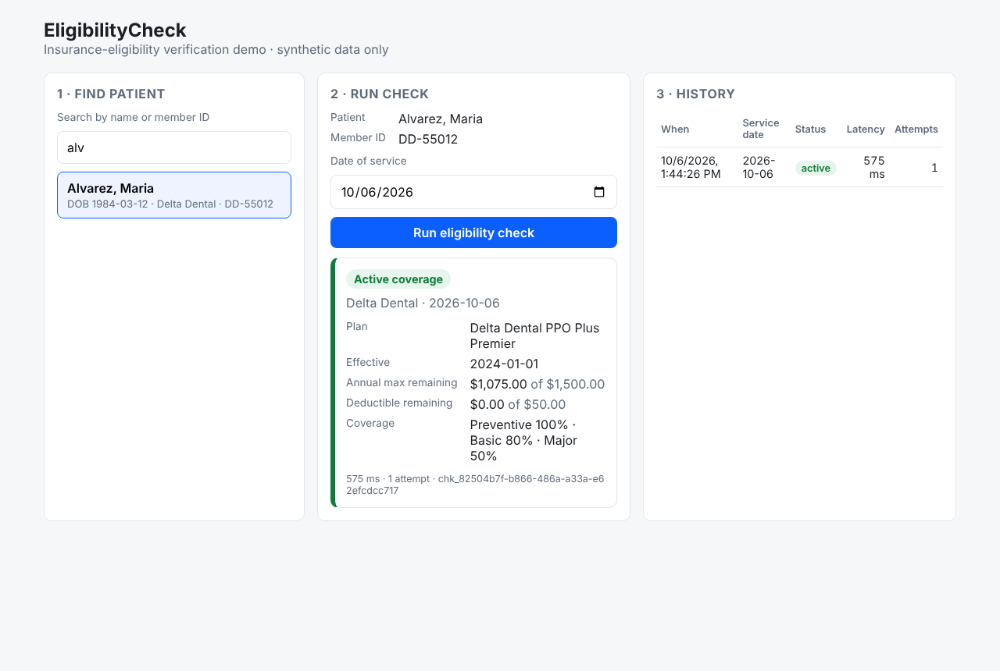

# EligibilityCheck

Insurance-eligibility verification, end to end: a front-desk user picks a patient, runs a check against the patient's payer, and gets a typed answer — active coverage with benefit math, inactive, member not found, or payer unavailable — with every check persisted for audit and latency reporting.

**React · TypeScript (strict) · Node/Express · SQL (Drizzle + SQLite) · zod · TanStack Query · Vitest/Supertest/RTL · GitHub Actions**

> Built as a sanitized, from-scratch demo of a problem I've solved in production for a multi-clinic dental group. All patients, payers, member IDs and plans here are invented; no employer code or data.



## Run it

```bash
pnpm install
pnpm dev          # API on :4000, web on :5173 — open http://localhost:5173
```

Node ≥ 20, pnpm ≥ 9. No database setup: SQLite is created and migrated on first start and demo patients are seeded automatically.

```bash
pnpm typecheck    # tsc --noEmit in every package
pnpm test         # 35 tests: unit (service, retry), integration (HTTP + SQLite), component (RTL)
pnpm build
```

## Demo scenarios

Each seeded patient exercises one code path. Search by last name:

| Patient | Payer / member | What happens |
|---|---|---|
| Alvarez | Delta Dental `DD-55012` | **Active** — deductible met, $1,075 of $1,500 annual max remaining |
| Okafor | MetLife `ML-88120` | **Active** — nearly exhausted annual max ($127 left) |
| Brooks | Delta Dental `DD-55099` | **Inactive** for a date of service after 2026-06-30; **active** before it |
| Lindqvist | MetLife `ML-00000` | **Not found** — unknown member |
| Ferreira | Cigna `CG-77210-TIMEOUT` | Payer times out twice, **retry succeeds on attempt 3** (watch the attempts column) |
| Whitfield | Delta Dental `DD-61000-AUTH` | Payer rejects credentials — **non-retryable payer-error**, no retry |

## Architecture

```
apps/web  (React + Vite)                       apps/api  (Express)
┌──────────────────────────┐   /api/*  proxy   ┌───────────────────────────────────────┐
│ PatientSearch (debounced)│ ───────────────▶  │ routes ── zod validate ── EligibilityService
│ CheckForm (RHF + zod)    │                   │                              │
│ ResultCard (exhaustive)  │ ◀───────────────  │              PayerRegistry ──┼── MockPayerAdapter (delta)
│ CheckHistory             │   zod-parsed      │              (per payerId)   ├── MockPayerAdapter (metlife)
└──────────────────────────┘   responses       │                              └── MockPayerAdapter (cigna)
             ▲                                 │              withRetry (exp. backoff + full jitter)
             │                                 │                              │
   packages/shared ──────────────────────────▶ │   CheckRepository / PatientRepository (ports)
   zod schemas = runtime validation + types    │        └── Drizzle + SQLite (migrated on boot)
                                               └───────────────────────────────────────┘
```

### Decisions worth asking me about

**One schema, both sides.** `packages/shared` holds zod schemas; the API validates requests and DB rows against them, the web client validates *responses* against them. The `EligibilityResult` type is a discriminated union on `status`, so an `inactive` result physically cannot carry a deductible and the `ResultCard` `switch` is checked for exhaustiveness by the compiler — add a fifth status and the UI fails to build until it's handled.

**Transport errors vs. business outcomes.** Adapters *return* every business answer (active/inactive/not-found) and *throw* only for transport failures (timeout, 5xx, auth). The service decides what to retry — only errors flagged `retryable` — and converts a final failure into a typed `payer-error` result. The HTTP layer never special-cases exceptions, and failures are persisted with the same shape as successes, which is what you want for an audit trail and an SLO dashboard.

**Retry with exponential backoff and full jitter.** `withRetry` sleeps `random(0, min(cap, base·2ⁿ))`. Jitter matters when 500 clinics hit a degraded payer at 8:00 AM: without it they retry in lock-step. The sleep and RNG are injectable, so the tests assert the exact delay sequence without waiting.

**Ports, not ORM, in the service.** `EligibilityService` depends on `PatientRepository`/`CheckRepository` interfaces. Unit tests use in-memory implementations (9 tests, ~10 ms); integration tests use the real Drizzle repos on an in-memory SQLite (`:memory:`) via Supertest. No mocking library needed for either.

**Money is integer cents** everywhere except the formatter at the UI edge. Dates are `YYYY-MM-DD` strings end to end — a date of service is a clinic-local calendar date, not an instant, and `toISOString().slice(0,10)` would shift it across midnight UTC.

**Composition root.** `apps/api/src/api/server.ts` is the only file that knows about concrete implementations (SQLite, mock payers, pino). `createApp(deps)` takes everything explicitly, which is why the test app is three lines.

**Strict TypeScript.** `strict`, `noUncheckedIndexedAccess`, `exactOptionalPropertyTypes`. Route params are typed through a generic `asyncHandler<{ id: string }>` rather than a cast. The one `never` in the codebase is the exhaustiveness check.

## API

| Method | Path | Notes |
|---|---|---|
| `GET` | `/health` | |
| `GET` | `/patients?q=&limit=` | name or member-ID search, max 100 |
| `GET` | `/patients/:id` | |
| `POST` | `/eligibility` | `{ patientId, serviceDate? }` → `201 { check }`; payer failures are still `201` with `result.status = "payer-error"` |
| `GET` | `/checks?patientId=&limit=` | newest first; omit `patientId` for recent across all patients |
| `GET` | `/checks/:id` | |

Errors are always `{ error: { code: "validation" | "not_found" | "internal", message, issues? } }`. Validation errors include per-field `issues` from zod.

## Production notes (what changes outside a demo)

- **Real payers:** swap `MockPayerAdapter` for one adapter per clearinghouse (X12 270/271 over a clearinghouse API) — the `PayerAdapter` interface and everything above it stay the same.
- **Postgres:** change the Drizzle driver (`drizzle-orm/node-postgres`) and the `sqliteTable` → `pgTable` column types; the repository code is unchanged. Keep `result_json` as `jsonb` and index `(patient_id, created_at desc)`.
- **PHI:** encrypt at rest, VPC-only DB, audit log on every read of `/checks`, and never log request bodies (`pino-http` here logs method/url/status only).
- **Async at scale:** put a queue between `POST /eligibility` and the payer call with an idempotency key per `(patientId, serviceDate, day)`, return `202` + poll, and move retry into the worker.
- **Caching:** payer answers are valid for a business day; cache `(payerId, memberId, serviceDate)` with a short TTL to cut payer calls and cost.

## Project layout

```
packages/shared   zod schemas, shared types, money helpers        (6 tests)
apps/api          Express API, Drizzle schema + migrations, payer adapters, service   (23 tests)
apps/web          Vite + React client                               (6 tests)
.github/workflows ci.yml — typecheck, test, build on every push/PR
```

## License

MIT
